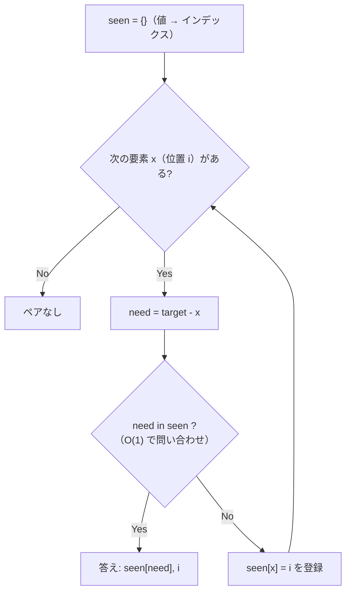

# 「見たものを覚えておく」ハッシュマップ

## こういう問題に効く

- 「和が target になる 2 つ」「差が k のペア」など、**ある要素の相方が決まっている**
- 「前に同じものが出てきたか」「何回出てきたか」を知りたい
- 素直に書くと二重ループ O(n²) になる

## 考え方

左から 1 つずつ見ながら、**見終わった要素を dict に記録**する。
各要素で「相方はもう出てきたか？」を dict に O(1) で問い合わせる。

```python
seen = {}                     # 値 -> インデックス
for i, x in enumerate(nums):
    need = target - x         # 相方
    if need in seen:
        return [seen[need], i]
    seen[x] = i               # 問い合わせの「後」に登録する（自分自身とペアにしない）
```

- 時間 O(n)、空間 O(n)。空間を使って時間を買うトレードオフ
- 登録と問い合わせの順序がポイント。同じ要素を 2 回使えない問題では「問い合わせ → 登録」

### 図で見る



`nums = [3, 2, 4]`, `target = 6` のとき:

| i | x | need | seen（問い合わせ時点） | 結果 |
| --- | --- | --- | --- | --- |
| 0 | 3 | 3 | `{}` | なし → `{3: 0}` を登録 |
| 1 | 2 | 4 | `{3: 0}` | なし → `{3: 0, 2: 1}` を登録 |
| 2 | 4 | 2 | `{3: 0, 2: 1}` | **2 がある → `[1, 2]`** |

i = 0 で `need = 3` を自分自身と取り違えないのは「問い合わせ → 登録」の順だから。

## バリエーション

- 個数を数える: `collections.Counter` / `defaultdict(int)`
- 累積和と組み合わせる: 「和が k の部分配列の数」は累積和を dict に記録する

## 参考リンク

- [Python 公式: dict（マッピング型）](https://docs.python.org/ja/3/library/stdtypes.html#mapping-types-dict)
- [Python Wiki: TimeComplexity](https://wiki.python.org/moin/TimeComplexity)（`in` や代入が平均 O(1) であることの一覧）
- ソート済みなら追加メモリなしで解ける別パターン → [二ポインタ](two-pointers.md)

## 関連問題

- [0001 Two Sum](../../problems/0001-two-sum/)
