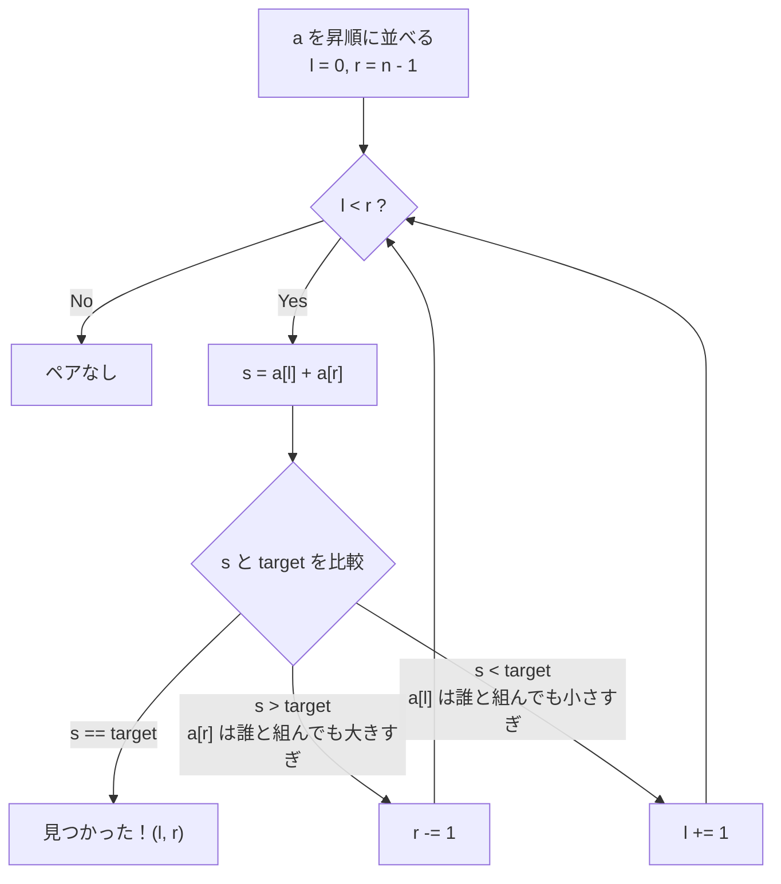

# 二ポインタ（尺取り法）— ソート済み配列の両端から寄せる

## こういう問題に効く

- **ソート済み**（またはソートしてよい）配列で「和が target になるペア」「差が k のペア」を探す
- 素直に書くと二重ループ O(n²) だが、「片方を動かすと和が単調に増える／減る」性質がある
- 3Sum のように「1 つ固定 + 残り 2 つをペア探索」に分解できる

> 「左右から寄せる型」のほかに、両方とも左から進む「区間を伸び縮みさせる型」（スライディングウィンドウ）もある。
> 日本の競プロ界隈では後者を特に「尺取り法」と呼ぶことが多い。

## 考え方

左端 `l` と右端 `r` を置き、和 `s = a[l] + a[r]` と `target` を比べる。

| 状態 | 何が言えるか | 動かすポインタ |
| --- | --- | --- |
| `s == target` | 見つかった | 終了 |
| `s > target` | `a[r]` は**残っている最小の `a[l]`** と組んでも大きすぎる → `a[r]` はもう誰とも組めない | `r -= 1` |
| `s < target` | `a[l]` は**残っている最大の `a[r]`** と組んでも小さすぎる → `a[l]` はもう誰とも組めない | `l += 1` |

1 回比べるごとに要素が 1 つ「候補から脱落」するので、最大 n − 1 回で終わる → **O(n)**。



### なぜ取りこぼさないのか（ペア表で見る）

全ペア `(i, j)`（i < j）を表にすると、右上の三角形になる。ソート済みなので **右に行くほど和が大きく、下に行くほど和が大きい**。

```
        j=1  j=2  j=3  j=4
  i=0    .    .    .   [*]   ← 出発点 (l=0, r=4)：右上の角
  i=1         .    .    .
  i=2              .    .
  i=3                   .
```

- `s > target` → その列（`j = r`）は上から下までもっと大きいので、**列ごと消す**（左へ 1 マス）
- `s < target` → その行（`i = l`）は右端でも足りないので、**行ごと消す**（下へ 1 マス）

右上の角から階段状に左下へ降りていき、1 ステップで 1 行か 1 列を丸ごと捨てる。だから O(n²) 個のペアを O(n) 回の比較で調べ尽くせる。

### トレース例

`a = [2, 7, 11, 15]`, `target = 9`

| step | l | r | a[l] + a[r] | 判定 |
| --- | --- | --- | --- | --- |
| 1 | 0 | 3 | 2 + 15 = 17 | 大きい → r を左へ |
| 2 | 0 | 2 | 2 + 11 = 13 | 大きい → r を左へ |
| 3 | 0 | 1 | 2 + 7 = 9 | 一致 |

## テンプレート

```python
def pair_with_sum(a: list[int], target: int) -> tuple[int, int] | None:
    """昇順ソート済みの a から和が target になる位置の組を返す"""
    l, r = 0, len(a) - 1
    while l < r:              # l == r にしないので同じ要素を 2 回使わない
        s = a[l] + a[r]
        if s == target:
            return l, r
        if s > target:
            r -= 1
        else:
            l += 1
    return None
```

- 計算量: 時間 O(n)（ソート込みなら O(n log n)）、空間 O(1)（ソートで新しい配列を作るなら O(n)）
- **元のインデックスを答える問題では、ソートで位置がずれる**。`(値, 元のインデックス)` の組でソートしておく → [配列のソート](../python/sort.md#元のインデックスを保ったままソートする)

## ハッシュマップとの使い分け

| | 二ポインタ | [ハッシュマップ](hashmap-lookup.md) |
| --- | --- | --- |
| 前提 | ソート済み（またはソートしてよい） | なし |
| 時間 | O(n)（ソート込み O(n log n)） | O(n) |
| 追加空間 | O(1) | O(n) |
| 得意 | 3Sum / 4Sum への拡張、重複スキップ、「最も近い和」 | 未ソート配列で一発、元インデックスをそのまま返す |

## 参考リンク

- [しゃくとり法 (尺取り法) の解説と、それを用いる問題のまとめ — Qiita (drken)](https://qiita.com/drken/items/ecd1a472d3a0e7db8dce)
- [167. Two Sum II - Input Array Is Sorted — LeetCode](https://leetcode.com/problems/two-sum-ii-input-array-is-sorted/)（二ポインタの練習にちょうどいい）
- [NeetCode Roadmap — Two Pointers](https://neetcode.io/roadmap)（パターン別の問題リスト）

## 関連問題

- [0001 Two Sum](../../problems/0001-two-sum/) — ソート + 二ポインタでも解ける（元インデックスの保持が必要）
